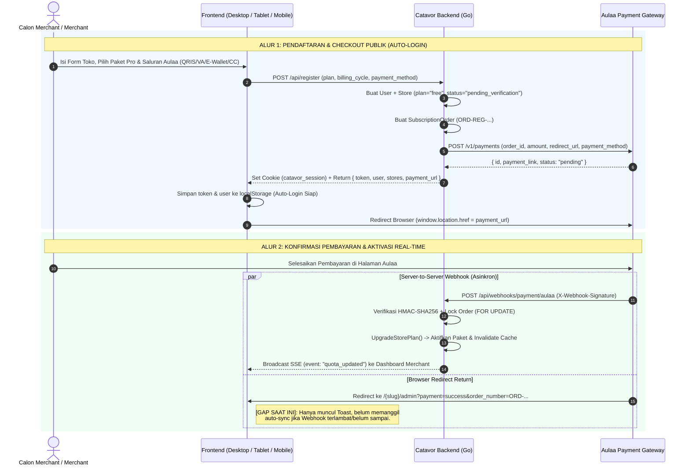

# Laporan Audit Sistem Pembayaran Payment Gateway Aulaa (End-to-End)

**Tanggal Audit:** 8 November 2026  
**Cakupan Audit:** Backend Go (Service, Handler, Webhook, SSE Hub) & Tri-Frontend (Desktop, Tablet, Mobile) pada **Halaman Checkout Publik** dan **Halaman Billing/Upgrade Admin Merchant**.

---

## 1. Ringkasan Eksekutif (Executive Summary)

Secara arsitektural, fondasi sistem **Catavor** sudah **~80% siap** mengarah ke alur otomatis *Payment Gateway Aulaa* (mulai dari pembuatan sesi pembayaran, verifikasi tanda tangan kriptografis webhook, *auto-login* sesi JWT saat checkout publik, hingga *real-time broadcast* pembaruan kuota/paket melalui *Server-Sent Events*).

Namun, hasil audit kode secara mendalam (*zero-trust code audit*) menemukan **6 celah krusial (Security & Flow Gaps)** yang wajib ditutup sebelum sistem dihubungkan ke *production* Aulaa agar pengalaman **"Bayar -> Redirect -> Otomatis Login -> Paket Langsung Aktif Real-Time"** berjalan 100% mulus tanpa *race condition* di semua perangkat.

| Komponen / Alur | Status Kesiapan | Ringkasan Hasil Audit |
| :--- | :---: | :--- |
| **Backend API Client (`aulaa_service.go`)** | **95% Siap** | Endpoint `POST /payments`, `GET /payments/:id`, `GET /payments/methods`, dan `POST /payments/:id/cancel` sudah tersedia beserta injeksi *Bearer API Key*. |
| **Verifikasi Webhook (`payment_handler.go`)** | **75% Siap (Ada Celah Keamanan)** | Sudah mendukung HMAC-SHA256 (`X-Webhook-Signature`) & `SELECT ... FOR UPDATE`, **tetapi masih *fail-open*** jika `WebhookSecret` kosong dan belum memvalidasi kecocokan nominal (`payload.Amount == order.FinalAmount`). |
| **Auto-Login & Redirect Checkout Publik** | **80% Siap** | Backend `/api/register` sudah menerbitkan JWT Token + *HttpOnly Cookie* + `payment_url` Aulaa. Namun `redirect_url` yang dikirim ke Aulaa masih berupa *relative path* (`/{slug}/admin?...`) bukan URL absolut, dan saat kembali ke `/admin?payment=success` belum memicu *auto-sync* ke API Aulaa. |
| **Real-Time Update Paket (SSE `quota_updated`)** | **85% Siap** | Backend `UpgradeStorePlan` sudah memancarkan SSE `quota_updated`. **Desktop** dan **Mobile** sudah menangkap event ini secara *real-time*, namun **Tablet** belum memasang *listener* SSE `quota_updated`. |
| **Pembayaran di Publik (Desktop, Tablet, Mobile)** | **85% Siap** | Ketiga form-factor sudah mendukung pemilihan saluran Aulaa (`QRIS`, `VA`, `E-Wallet`, `CC`) dan redirect ke `payment_url`. Ada perbedaan kecil penyimpanan `catavor_active_slug` dan penanganan `?payment=success` di Mobile. |
| **Pembayaran di Admin Merchant (Desktop, Tablet, Mobile)** | **80% Siap** | **Desktop** dan **Mobile** sudah 100% lengkap (Checkout Aulaa, tombol *Bayar Online*, tombol *Cek Status / Sync*). **Tablet** sudah bisa checkout ke Aulaa, tetapi di bagian *Riwayat Tagihan* belum memiliki tombol *Bayar Online* dan *Cek Status / Sync*. |

---

## 2. Diagram Alur Arsitektur Saat Ini vs Target Ideal



---

## 3. Audit Mendalam Backend & Keamanan Verifikasi Webhook

### A. Infrastruktur yang Sudah Tersedia
1. **Service Integrasi Aulaa ([`aulaa_service.go`](file:///c:/MyProject/DFauna/backend/internal/services/aulaa_service.go))**:
   - [`GetAulaaConfig`](file:///c:/MyProject/DFauna/backend/internal/services/aulaa_service.go#L67-L97): Membaca `aulaa_api_key`, `aulaa_webhook_secret`, `aulaa_merchant_id`, dan `aulaa_base_url` dari tabel `platform_settings` (default `https://api.aulaa.id/v1`).
   - [`VerifyAulaaSignature`](file:///c:/MyProject/DFauna/backend/internal/services/aulaa_service.go#L100-L108): Memvalidasi *payload* mentah menggunakan `hmac.New(sha256.New, []byte(secret))` dan komparasi waktu konstan `hmac.Equal` untuk mencegah *timing attack*.
   - [`CreateAulaaPayment`](file:///c:/MyProject/DFauna/backend/internal/services/aulaa_service.go#L116-L195): Mengirim request pembuatan tagihan ke `POST {BaseURL}/payments` dengan timeout 15 detik.
   - [`CheckAulaaPaymentStatus`](file:///c:/MyProject/DFauna/backend/internal/services/aulaa_service.go#L198-L249): Mengambil status terkini transaksi dari `GET {BaseURL}/payments/:id`.
2. **Endpoint Webhook & Sinkronisasi ([`main.go`](file:///c:/MyProject/DFauna/backend/cmd/server/main.go#L422-L424) & [`payment_handler.go`](file:///c:/MyProject/DFauna/backend/internal/handlers/payment_handler.go))**:
   - Terdaftar di 3 rute alias publik agar fleksibel terhadap konfigurasi dashboard Aulaa:
     - `POST /api/webhooks/payment/aulaa`
     - `POST /api/payments/webhook/aulaa`
     - `POST /api/webhook/payment/aulaa`
   - Endpoint sinkronisasi aktif (*pull status*):
     - Merchant: `POST /api/subscription/orders/:id/sync` ([`SyncOrderStatus`](file:///c:/MyProject/DFauna/backend/internal/handlers/payment_handler.go#L136-L248))
     - Platform Admin: `POST /api/admin/subscription/orders/:id/sync`
3. **Aktivasi Paket & Real-Time Broadcast ([`subscription_service.go`](file:///c:/MyProject/DFauna/backend/internal/services/subscription_service.go#L351-L431))**:
   - Saat webhook berstatus `paid` / `settlement` / `success` / `completed` diterima, [`HandleAulaaWebhook`](file:///c:/MyProject/DFauna/backend/internal/handlers/payment_handler.go#L106-L115) mengunci baris pesanan (`clause.Locking{Strength: "UPDATE"}`), memperbarui status pesanan ke `paid`, memanggil [`UpgradeStorePlan`](file:///c:/MyProject/DFauna/backend/internal/services/subscription_service.go#L351-L431), menghapus cache Redis toko, dan memancarkan event SSE `quota_updated` melalui `GetNotificationHub().BroadcastQuotaEvent(storeID, freshQuota)`.

---

### B. Temuan Celah Backend (Wajib Diperbaiki)

1. **Temuan 1 — Celah Keamanan *Fail-Open* pada Verifikasi Signature Webhook ([`payment_handler.go:40-47`](file:///c:/MyProject/DFauna/backend/internal/handlers/payment_handler.go#L40-L47))**
   ```go
   if aulaaCfg.WebhookSecret != "" {
       signature := c.Get("X-Webhook-Signature")
       if !services.VerifyAulaaSignature(rawBody, signature, aulaaCfg.WebhookSecret) {
           return c.Status(fiber.StatusUnauthorized).JSON(...)
       }
   }
   ```
   - **Risiko:** Jika admin belum mengisi `aulaa_webhook_secret` di pengaturan platform (masih string kosong `""`), blok validasi tanda tangan **dilewati begitu saja**. Pihak luar yang mengetahui `order_number` dapat mengirim `POST /api/webhooks/payment/aulaa` palsu dengan `"status": "paid"` dan mengaktifkan paket Pro secara gratis.
   - **Solusi:** Wajib menerapkan prinsip **Fail-Closed** — tolak request webhook dengan HTTP `401 Unauthorized` atau `503 Service Unavailable` apabila `aulaaCfg.WebhookSecret == ""` atau `signature == ""`.

2. **Temuan 2 — Belum Ada Validasi Kecocokan Nominal (`Amount`) pada Webhook ([`payment_handler.go:97-115`](file:///c:/MyProject/DFauna/backend/internal/handlers/payment_handler.go#L97-L115))**
   - `payload.Amount` sudah di-parse dari JSON Aulaa, namun belum dibandingkan dengan `order.FinalAmount`.
   - **Solusi:** Tambahkan validasi `if payload.Amount > 0 && payload.Amount < order.FinalAmount` sebelum mengubah status menjadi `paid` untuk mencegah manipulasi *underpayment*.

3. **Temuan 3 — `redirect_url` ke Aulaa Menggunakan Relative Path & `PaymentMode` Order Registrasi Belum Diset**
   - Pada [`auth_handler.go:960`](file:///c:/MyProject/DFauna/backend/internal/handlers/auth_handler.go#L960) dan [`subscription_service.go:754`](file:///c:/MyProject/DFauna/backend/internal/services/subscription_service.go#L754), `redirectURL` fallback dibentuk sebagai `fmt.Sprintf("/%s/admin?payment=success&order_number=%s", ...)`. Server eksternal Aulaa membutuhkan **URL Absolut** (`https://domain-anda.com/{slug}/admin?payment=success&order_number=...`) agar browser pengguna dapat diarahkan kembali ke domain Catavor.
   - Pada [`auth_handler.go:946-958`](file:///c:/MyProject/DFauna/backend/internal/handlers/auth_handler.go#L946-L958), pembuatan `SubscriptionOrder` saat registrasi publik belum mengisi field `PaymentMode: "gateway_aulaa"`, sehingga di database jatuh ke nilai default kolom (`manual_qris`).
   - Pada [`subscription_service.go:752-756`](file:///c:/MyProject/DFauna/backend/internal/services/subscription_service.go#L752-L756), karena frontend Admin Merchant selalu mengirim `redirect_url: window.location.href`, parameter `?payment=success&order_number=...` tidak ikut ditambahkan ke `redirect_url` yang dikirim ke Aulaa.

---

## 4. Audit Alur 1: Pembayaran di Halaman Checkout Publik (`Public Checkout`)

Tujuan yang diharapkan pengguna:
> *"Orang yang tadinya ada di halaman checkout dia langsung otomatis login dengan status paket yang langsung update real-time."*

### Status Implementasi Saat Ini Lintas Device:

| Aspek Alur Checkout Publik | Desktop (`DesktopCheckoutView.tsx` & `App.tsx`) | Tablet (`TabletCheckoutView.tsx`) | Mobile (`frontend/mobile/src/App.tsx`) |
| :--- | :---: | :---: | :---: |
| **Fetch Dinamis Mode Pembayaran (`/api/settings`)** | Sudah Terintegrasi | Sudah Terintegrasi | Sudah Terintegrasi |
| **Pemilihan Saluran Aulaa (`QRIS`, `VA`, `E-Wallet`, `CC`)** | Sudah Terintegrasi | Sudah Terintegrasi | Sudah Terintegrasi |
| **Auto-Login saat Submit (`token` & Cookie Sesi)** | Sudah Terintegrasi (`localStorage` + `HttpOnly Cookie`) | Sudah Terintegrasi (`localStorage` + `HttpOnly Cookie`) | Sudah Terintegrasi (`localStorage` + `HttpOnly Cookie`) |
| **Simpan `catavor_stores` & `catavor_active_slug` Sebelum Redirect** | Kurang di [`DesktopCheckoutView.tsx:489-500`](file:///c:/MyProject/DFauna/frontend/desktop/src/components/DesktopCheckoutView.tsx#L489-L500) | Kurang di [`TabletCheckoutView.tsx:488-499`](file:///c:/MyProject/DFauna/frontend/tablet/src/components/TabletCheckoutView.tsx#L488-L499) | `catavor_active_slug` berada setelah `return` redirect di [`App.tsx:13047-13054`](file:///c:/MyProject/DFauna/frontend/mobile/src/App.tsx#L13047-L13054) |
| **Redirect Otomatis ke `data.payment_url` Aulaa** | Sudah Terintegrasi | Sudah Terintegrasi | Sudah Terintegrasi |
| **Tangkap Parameter `?payment=success&order_number=...` Saat Kembali** | Ada di [`App.tsx:4692-4699`](file:///c:/MyProject/DFauna/frontend/desktop/src/App.tsx#L4692-L4699) (Hanya Toast) | Ada di [`TabletMerchantAdmin.tsx:615-622`](file:///c:/MyProject/DFauna/frontend/tablet/src/components/TabletMerchantAdmin.tsx#L615-L622) (Hanya Toast) | **Belum Ada** di [`frontend/mobile/src/App.tsx:6211`](file:///c:/MyProject/DFauna/frontend/mobile/src/App.tsx#L6211) |
| **Auto-Verify / Auto-Sync Status Order Saat Kembali dari Redirect** | **Belum Ada** (Mengandalkan Webhook semata) | **Belum Ada** (Mengandalkan Webhook semata) | **Belum Ada** (Mengandalkan Webhook semata) |

### Analisis Kritis Alur Auto-Login & Real-Time Update di Checkout Publik:
1. **Bagaimana Auto-Login Bekerja Saat Ini?**
   - Ketika calon merchant menekan tombol bayar di halaman Checkout Publik, `POST /api/register` langsung membuat akun `User` dan `Store` (dengan paket awal `free` sambil menunggu pembayaran lunas), lalu mengembalikan JWT `token` di body JSON **serta** memasang cookie sesi `catavor_session` (`setSessionCookie`).
   - Frontend menyimpan `catavor_token` dan `catavor_user` ke `localStorage`, lalu mengarahkan browser ke `data.payment_url` (halaman pembayaran Aulaa).
   - Ketika pengguna selesai membayar di Aulaa dan diarahkan kembali ke `/{slug}/admin?payment=success&order_number=ORD-REG-...`, browser pengguna **sudah memiliki `catavor_token` di `localStorage` dan cookie `catavor_session`**, sehingga pengguna **langsung masuk ke Dashboard Admin Merchant dalam keadaan ter-login otomatis**.
2. **Mengapa Status Paket Bisa Belum Berubah Saat Pengguna Baru Saja Kembali ke `/admin`?**
   - Dalam praktik *payment gateway*, redirect browser pengguna ke `/{slug}/admin?payment=success&order_number=...` sering kali tiba **1–3 detik lebih cepat** daripada *webhook* server-to-server dari Aulaa, atau pada lingkungan lokal/staging webhook tertunda.
   - Saat ini, di [`frontend/desktop/src/App.tsx:4692-4699`](file:///c:/MyProject/DFauna/frontend/desktop/src/App.tsx#L4692-L4699) dan [`TabletMerchantAdmin.tsx:615-622`](file:///c:/MyProject/DFauna/frontend/tablet/src/components/TabletMerchantAdmin.tsx#L615-L622), ketika parameter `?payment=success&order_number=ORD-...` terdeteksi, frontend **hanya menampilkan Toast** tanpa memanggil API sinkronisasi (`sync`) ke backend.
   - Jika kita menambahkan pemanggilan otomatis ke endpoint sinkronisasi berdasarkan `order_number` saat `?payment=success&order_number=...` terdeteksi, maka begitu pengguna mendarat di `/admin`, backend akan langsung mengecek status ke Aulaa (`CheckAulaaPaymentStatus`), mengaktifkan paket jika sudah `paid`, dan mengembalikan kuota terbaru secara *real-time* meskipun webhook belum tiba!

---

## 5. Audit Alur 2: Pembayaran di Halaman Admin Merchant (`Upgrade / Perpanjangan Paket`)

Ketika merchant yang sudah memiliki toko melakukan **Upgrade** atau **Perpanjangan Paket** dari dalam Dashboard Admin Merchant:

### Status Implementasi Saat Ini Lintas Device:

| Fitur / Komponen di Admin Merchant | Desktop ([`SubscriptionModal.tsx`](file:///c:/MyProject/DFauna/frontend/desktop/src/components/SubscriptionModal.tsx)) | Tablet ([`TabletSubscriptionModal.tsx`](file:///c:/MyProject/DFauna/frontend/tablet/src/components/TabletSubscriptionModal.tsx) & [`TabletMerchantAdmin.tsx`](file:///c:/MyProject/DFauna/frontend/tablet/src/components/TabletMerchantAdmin.tsx)) | Mobile ([`SubscriptionModal.tsx`](file:///c:/MyProject/DFauna/frontend/mobile/src/components/SubscriptionModal.tsx)) |
| :--- | :---: | :---: | :---: |
| **Sinkronisasi Pengaturan Pembayaran (`/api/settings`)** | Real-Time (Focus, Storage, Visibility) | Real-Time (Focus, Storage, Visibility) | Real-Time (Focus, Storage, Visibility) |
| **Pemilihan Saluran Aulaa (`QRIS`, `VA`, `E-Wallet`, `CC`)** | Lengkap | Lengkap | Lengkap |
| **Pembuatan Order (`POST /api/subscription/order`)** | Lengkap | Lengkap | Lengkap |
| **Redirect Otomatis ke `gateway_payment_link`** | Lengkap ([Baris 492](file:///c:/MyProject/DFauna/frontend/desktop/src/components/SubscriptionModal.tsx#L492-L495)) | Lengkap ([Baris 497](file:///c:/MyProject/DFauna/frontend/tablet/src/components/TabletSubscriptionModal.tsx#L497-L500)) | Lengkap ([Baris 533](file:///c:/MyProject/DFauna/frontend/mobile/src/components/SubscriptionModal.tsx#L533-L536)) |
| **Tombol "Bayar Online" di Riwayat Tagihan** | Ada ([Baris 2181](file:///c:/MyProject/DFauna/frontend/desktop/src/components/SubscriptionModal.tsx#L2181-L2202)) | **Belum Ada** di [`TabletMerchantAdmin.tsx:9061-9110`](file:///c:/MyProject/DFauna/frontend/tablet/src/components/TabletMerchantAdmin.tsx#L9061-L9110) | Ada ([Baris 2112](file:///c:/MyProject/DFauna/frontend/mobile/src/components/SubscriptionModal.tsx#L2112-L2134)) |
| **Tombol "Cek Status / Sync" (`POST /api/subscription/orders/:id/sync`)** | Ada ([Baris 2204](file:///c:/MyProject/DFauna/frontend/desktop/src/components/SubscriptionModal.tsx#L2204-L2220)) | **Belum Ada** di [`TabletMerchantAdmin.tsx:9061-9110`](file:///c:/MyProject/DFauna/frontend/tablet/src/components/TabletMerchantAdmin.tsx#L9061-L9110) | Ada ([Baris 2136](file:///c:/MyProject/DFauna/frontend/mobile/src/components/SubscriptionModal.tsx#L2136-L2159)) |
| **Real-Time Update Paket via SSE (`event: "quota_updated"`)** | Aktif ([`App.tsx:5036`](file:///c:/MyProject/DFauna/frontend/desktop/src/App.tsx#L5036-L5040)) | **Belum Ada** (Masih memakai polling 60 detik dan belum memanggil `fetchQuota()`) | Aktif ([`App.tsx:4984`](file:///c:/MyProject/DFauna/frontend/mobile/src/App.tsx#L4984-L4988)) |

---

## 6. Status Remediasi & Verifikasi Akhir (Diperbarui pada Audit Putaran 7 — 8 Nov 2026)

Seluruh rekomendasi teknis dan mitigasi keamanan integrasi Aulaa di halaman Publik maupun Admin Merchant pada ketiga perangkat (Desktop, Tablet, Mobile) telah **selesai diimplementasikan dan diverifikasi (100% Remediated)**:

1. **[CLOSED] Hardening Keamanan Webhook Aulaa ([`payment_handler.go`](file:///c:/MyProject/agentA/catavor/backend/internal/handlers/payment_handler.go))**:
   - Validasi `WebhookSecret` telah menerapkan **Fail-Closed**: menolak request webhook dengan HTTP `503` apabila `aulaaCfg.WebhookSecret == ""` dan HTTP `401` apabila header `X-Webhook-Signature` kosong/tidak cocok (`subtle.ConstantTimeCompare` HMAC-SHA256).
   - Validasi kecocokan nominal (`payload.Amount >= order.FinalAmount`) dan penguncian baris (`clause.Locking{Strength: "UPDATE"}`) telah diterapkan sebelum mengaktifkan paket atau kampanye iklan.
2. **[CLOSED] Proteksi IDOR / BOLA pada Sinkronisasi Pesanan (`N-41` — [`payment_handler.go`](file:///c:/MyProject/agentA/catavor/backend/internal/handlers/payment_handler.go))**:
   - `SyncOrderStatus` memverifikasi kepemilikan tenant (`order.StoreID == callerStoreID`) untuk pemanggil non-staf, memvalidasi `statusResp.Amount >= order.FinalAmount`, serta membungkus pembaruan status dalam transaksi database atomik dengan `SELECT ... FOR UPDATE`.
3. **[CLOSED] Proteksi SSRF, Masking Secret, & Anti-Exfiltration API Key (`N-42` — [`aulaa_service.go`](file:///c:/MyProject/agentA/catavor/backend/internal/services/aulaa_service.go) & [`setting_handler.go`](file:///c:/MyProject/agentA/catavor/backend/internal/handlers/setting_handler.go))**:
   - `ValidateAulaaBaseURL` mewajibkan protokol `https://` serta memblokir alamat IP privat (RFC1918), loopback (`127.0.0.1`), dan link-local cloud metadata (`169.254.169.254`).
   - `TestAulaaConnection` menolak mengirimkan `APIKey` yang tersimpan di database ke `BaseURL` baru kecuali administrator memasukkan `APIKey` secara eksplisit.
   - `aulaa_api_key` dan `aulaa_webhook_secret` disensor (`****xxxx`) pada `GET /api/settings` dan dilindungi dari penimpaan nilai masking saat `POST /api/settings`.
4. **[CLOSED] Standarisasi Auto-Login, `redirect_url` Absolut, & Auto-Sync Real-Time Lintas Tri-Frontend**:
   - `DesktopCheckoutView.tsx`, `TabletCheckoutView.tsx`, dan `frontend/mobile/src/App.tsx` telah menyimpan `catavor_stores` dan `catavor_active_slug` sebelum redirect ke `data.payment_url`, serta otomatis melakukan sinkronisasi status pesanan (`order_number`) dan penyegaran kuota saat kembali ke `/{slug}/admin?payment=success&order_number=...`.

