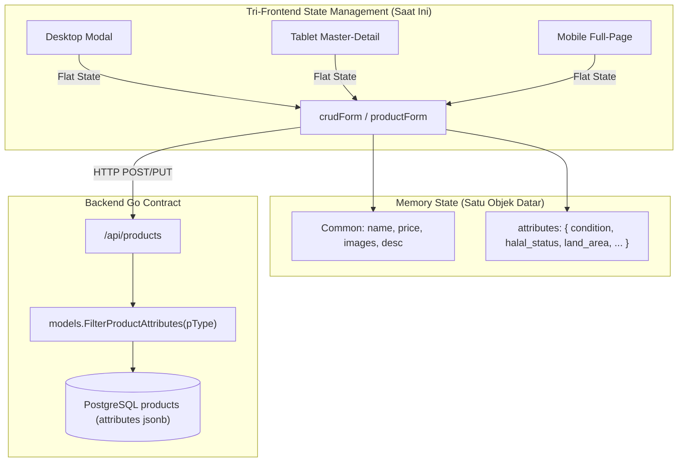

# Laporan Audit & Rekomendasi Standar Industri: Mekanisme Pergantian Tipe Katalog (Catalog Type Switch)

---

## 1. Executive Summary & Jawaban Langsung

Menjawab pertanyaan strategis Anda mengenai alur pergantian tipe katalog pada formulir produk/item:

1. **Apakah isian field umum (general fields) boleh hilang saat user berganti tipe katalog?**
   - **Jawaban Standar Industri**: **HARAM HILANG (Wajib Dipertahankan / Preserved 100%)**.
   - Bidang seperti *Nama Produk*, *Harga*, *Deskripsi*, *Foto Galeri*, *Link Video*, *Syarat Pengiriman*, dan *Kontak WhatsApp* adalah data kanonikal entitas. Memaksa pengguna mengetik ulang atau mengunggah ulang foto dari nol hanya karena salah memilih tipe katalog dianggap sebagai **Critical UX Anti-Pattern (Severe User Friction & Data Loss)** di industri SaaS modern.

2. **Bagaimana jika pengguna berganti tipe katalog, lalu kembali lagi ke tipe sebelumnya (A $\rightarrow$ B $\rightarrow$ A)? Apakah isian tipe sebelumnya tetap ada atau di-reset?**
   - **Jawaban Standar Industri**: **Wajib Tetap Ada Menggunakan Pola *Scoped Multi-Type Draft Buffer***.
   - Pengguna sering kali mengeksplorasi atau membandingkan format katalog (misalnya: *"Apakah produk ini lebih cocok masuk ke Barang Fisik atau Kuliner/Hampers?"*). Standar terbaik industri mengisolasi draf atribut per tipe katalog, sehingga ketika pengguna kembali ke tipe A, seluruh atribut spesifik yang sudah pernah diisi pada tipe A kembali utuh tanpa terhapus dan tanpa tercampur dengan atribut tipe B.

---

## 2. Audit Faktual Kondisi Sistem Catavor Saat Ini

Audit dilakukan secara mendalam (*zero-trust code audit*) langsung pada codebase ketiga frontend dan backend:



### A. Kondisi di Desktop (`frontend/desktop/src/App.tsx`)
- **Letak Komponen**: Crud Modal (`showCrudModal`), bar pilihan 7 tipe item di baris atas formulir (grid 7 tombol: `Barang Fisik`, `Kuliner`, `Item Digital`, `Jasa`, `Tanaman`, `Hewan`, `Properti`).
- **Mekanisme Ganti Tipe**: Pengguna mengklik salah satu tombol tipe di bar atas kapan saja saat modal terbuka.
- **Perilaku State Saat Ini**:
  - Field umum (`name`, `price`, `description`, `crudImages`, dll.) **sudah dipertahankan** (`setCrudForm(prev => ({ ...prev, product_type: cat.id }))`).
  - Field atribut spesifik (`attributes`) **masih tertinggal di memori** dalam satu dictionary objek datar.
  - **Kelemahan/Bug Faktual Saat Ini**:
    - **Sub-Kategori (`class`) Ter-reset**: Baris 29789–29794 mengecek apakah kategori lama valid di tipe baru. Jika tidak, `class` otomatis diganti menjadi `defaultCategory` tipe baru. Ketika pengguna kembali ke tipe awal (misal: Fisik `Pakaian Pria` $\rightarrow$ Kuliner $\rightarrow$ Fisik), sub-kategori Fisik tidak ingat pilihan sebelumnya dan ter-reset ke default (`Elektronik & Gadget`).
    - **Tanpa Isolasi Atribut**: Seluruh atribut dari berbagai tipe bertumpuk di satu dictionary `crudForm.attributes`.
    - **Zero Feedback**: Tidak ada indikator visual atau notifikasi yang meyakinkan pengguna bahwa data umum mereka tetap aman saat beralih tipe.

### B. Kondisi di Tablet (`frontend/tablet/src/components/TabletMerchantAdmin.tsx`)
- **Letak Komponen**: Master-Detail Split View dengan alur 2-Step. Step 1 (Daftar 7 Kartu Spesialisasi Katalog) $\rightarrow$ Step 2 (Formulir Pengisian).
- **Mekanisme Ganti Tipe**: Di Step 2, pengguna menekan tombol "Kembali" / back interceptor `handleBackToTypeSelection` menuju Step 1, lalu memilih kartu tipe lain.
- **Perilaku State Saat Ini**:
  - `handleBackToTypeSelection` mempertahankan `...prev` dan hanya mengosongkan `product_type: ''`.
  - Field umum (`name`, `price`, `productPhotos`, dll.) **tetap aman**.
  - `attributes` di-spread (`defaultAttrs = { ...(prev.attributes || {}) }`).
  - **Kelemahan/Bug Faktual Saat Ini**:
    - Sama seperti Desktop, jika pengguna beralih tipe lalu kembali, sub-kategori (`class`) ter-reset ke kategori default pertama.
    - Jika pengguna menekan tombol "Batal" di Step 1, `selectedProductId` di-set `null` dan seluruh draf form yang baru dibuat tertutup (bukan sekadar membatalkan ganti tipe).

### C. Kondisi di Mobile (`frontend/mobile/src/App.tsx`)
- **Letak Komponen**: Full-Page View (`fauna-editor`). Memiliki banner khusus di atas form bertuliskan: **"Tipe Item Katalog: [Nama Tipe] [Ganti Tipe]"**.
- **Mekanisme Ganti Tipe**: Menekan tombol `[Ganti Tipe]` mengaktifkan `isChangingTypeInEditor(true)` dan membuka halaman pemilihan tipe (`product-type-selector`).
- **Perilaku State Saat Ini**:
  - Saat memilih tipe baru, handler `handleSelectProductType` mendeteksi flag `isChangingTypeInEditor` dan mempertahankan `...prev` tanpa memanggil `resetCrudState`.
  - Menekan tombol "Batal" di `product-type-selector` dengan aman mengembalikan pengguna ke `fauna-editor` tanpa menghilangkan data.
  - **Kelemahan/Bug Faktual Saat Ini**:
    - Draf atribut spesifik per tipe belum diisolasi (*flat memory buffer*).
    - Sub-kategori (`class`) ter-reset ke default saat bolak-balik tipe.

### D. Kondisi di Backend Go (`backend/internal/models/product_attribute_schema.go`)
- Backend memiliki kontrak arsitektur yang sangat ketat:
  ```go
  var ProductAttributeSchema = map[string][]string{
      "physical": {"brand", "material", "condition", "weight", "min_order", "max_order", "variant"},
      "food":     {"halal_status", "expired_info", "storage_temp", "variant", ...},
      "service":  {"duration", "service_area", "service_location", ...},
      ...
  }
  ```
- Fungsi `FilterProductAttributes(pType, req.Attributes)` membuang seluruh atribut yang tidak termasuk dalam allow-list tipe aktif saat disimpan ke PostgreSQL (`jsonb`).
- **Implikasi Positif**: Backend **sudah sangat siap dan aman**. Apabila frontend mengirim atribut tipe lain yang tertinggal di memori, backend otomatis membuangnya sehingga database tidak pernah mengalami *data pollution*.

---

## 3. Telaah Standar Industri & Best Practices Komparatif

Di industri e-commerce dan multi-vertical SaaS global (seperti Shopify, WooCommerce, Tokopedia, GrabFood/GoFood Merchant, dan Airbnb), terdapat 3 model pendekatan:

| Parameter | Model 1: Destructive Reset (Hard Reset) | Model 2: Flat State Persistence (Kondisi Catavor Saat Ini) | Model 3: Scoped Multi-Type Draft Buffer (Standar Industri Emas) |
| :--- | :--- | :--- | :--- |
| **Deskripsi** | Setiap ganti tipe, formulir dikosongkan total kembali ke state awal. | Field umum & atribut digabung dalam 1 objek memori datar. | Field umum bersifat global; atribut spesifik disimpan dalam buffer per tipe (`typeDrafts[type]`). |
| **Data Umum (Nama, Foto, Harga, Deskripsi)** | ❌ Hilang total (harus isi & upload ulang) | ✅ Dipertahankan | ✅ Dipertahankan |
| **Skenario Bolak-Balik (A $\rightarrow$ B $\rightarrow$ A)** | ❌ Hilang total | ⚠️ Atribut ada, tapi kategori (`class`) & default bisa tertimpa/rusak | ✅ **100% Utuh & Sempurna** (kembali ke kondisi persis sebelum ditinggal) |
| **Konflik Atribut Serupa** | Tidak ada (karena bersih) | ⚠️ Rentan bentrok semantik (misal `weight` fisik vs hewan) | ✅ **Nol Konflik** (terisolasi per namespace tipe) |
| **User Experience (UX)** | 🔴 Sangat Buruk (Frustrasi tinggi jika salah klik) | 🟡 Cukup Baik (tetapi ada glitch kategori & kebingungan user) | 🟢 **Sempurna & Elegan** (Bebas cemas, fleksibel, responsif) |
| **Adopsi Industri** | Sistem legacy lama / form sederhana | Platform startup tahap awal | **Shopify, Airbnb, Grab Merchant, Catavor Enterprise** |

---

## 4. Rekomendasi Solusi & Desain Arsitektur (Model 3: Scoped Multi-Type Draft Buffer)

Rekomendasi terbaik yang sejalan dengan arsitektur Catavor dan standar `AGENTS.md` adalah mengadopsi **Scoped Multi-Type Draft Buffer**:

### A. Struktur State Dual-Layer yang Direkomendasikan
Pisahkan state form menjadi 2 komponen terstruktur:
1. **Canonical Common State** (Data agnostik tipe):
   ```typescript
   // Berlaku universal untuk seluruh tipe katalog
   const commonData = {
     name: string,
     price: number,
     description: string,
     images: string[],
     video_url: string,
     is_shipping_available: boolean,
     shipping_terms: string,
     warranty_info: string,
     purchase_links: Array<{ platform: string, url: string }>,
     enable_wa_rekber: boolean,
     enable_wa_direct: boolean,
     whatsapp_contact_id: string,
     min_order: number,
     max_order: number | null
   };
   ```

2. **Scoped Type Draft Buffer** (Data spesifik tipe):
   ```typescript
   // Menyimpan draf masing-masing tipe secara terisolasi di memori
   const [typeDrafts, setTypeDrafts] = useState<Record<ItemCategoryType, {
     class: string;
     shipping_coverage: string;
     conservation_status: string;
     attributes: Record<string, any>;
   }>>({
     physical: { class: 'Elektronik & Gadget', shipping_coverage: '...', conservation_status: 'Tersedia', attributes: { condition: 'Baru', weight: 100 } },
     food: { class: 'Makanan Siap Santap', shipping_coverage: '...', conservation_status: 'Tersedia', attributes: { halal_status: '...', storage_temp: 'Suhu Ruang' } },
     digital: { ... },
     service: { ... },
     plant: { ... },
     fauna: { ... },
     property: { ... }
   });
   ```

### B. Alur Transisi Saat Pergantian Tipe (Switching Lifecycle)
Ketika pengguna mengklik tipe baru (misal dari `physical` ke `food`):
1. **Simpan Snapshot Tipe Saat Ini**:
   Simpan `class`, `shipping_coverage`, `conservation_status`, dan `attributes` saat ini ke dalam `typeDrafts['physical']`.
2. **Aktifkan Draf Tipe Tujuan**:
   Ambil data dari `typeDrafts['food']`. Jika pengguna belum pernah mengisi tipe `food` pada sesi ini, gunakan template default `food`. Jika sudah pernah mengisi sebelumnya, kembalikan seluruh nilai yang pernah diketik pengguna.
3. **Pertahankan Data Universal**:
   `name`, `price`, `description`, `images`, dan kontak tidak disentuh sama sekali.
4. **Berikan Feedback Halus (Micro-Feedback Toast / Badge)**:
   Tampilkan toast atau badge status halus di samping pemilih tipe:
   > *"Format katalog beralih ke Kuliner. Data umum & foto dipertahankan."*

---

## 5. Matriks Penyelarasan Lintas Form-Factor (Desktop, Tablet, Mobile)

| Form-Factor | UI Entry Point Pergantian Tipe | Feedback & Konfirmasi | Safeguard Navigasi |
| :--- | :--- | :--- | :--- |
| **Desktop Native** | Baris pill grid 7 tombol di header modal input (`repeat(7, 1fr)`). | Ganti instan (1 tap). Menampilkan tooltip/badge halus: *"Draf tersimpan"* jika berpindah. | Tombol close modal "✕" atau Esc memicu pengecekan `isFormDirty()`. |
| **Tablet Native** | Tombol *"Ganti Format"* di header form Step 2 yang mengarahkan kembali ke kartu Step 1. | Saat memilih kartu tipe baru, form Step 2 memuat draf terisolasi tipe tersebut. | Hardware / gesture swipe back kembali dari Step 2 ke Step 1 tanpa menghapus data umum. |
| **Mobile Native** | Banner ringkas di atas form `fauna-editor`: `[Ganti Tipe]` $\rightarrow$ membuka `product-type-selector`. | Memilih tipe menutup selector dan kembali ke `fauna-editor` dengan draf tipe terpilih. | Tombol "Batal" di header selector kembali ke editor tanpa mereset form. |

---

## 6. Kesimpulan & Rekomendasi Langkah Selanjutnya

1. **Konsep Saat Ini Sudah 70% Benar**: Sistem Catavor saat ini sudah menerapkan prinsip tidak mereset data umum (nama, harga, deskripsi, foto tetap aman).
2. **Kekurangan yang Perlu Disempurnakan**:
   - Memori atribut belum diisolasi per tipe sehingga saat bolak-balik tipe (A $\rightarrow$ B $\rightarrow$ A), sub-kategori (`class`) ter-reset ke default dan ada risiko atribut saling timpa.
   - Perlu penambahan **Scoped Type Draft Buffer** agar pergantian tipe katalog menjadi 100% mulus, profesional, dan bebas dari kehilangan data sub-kategori maupun atribut spesifik.

