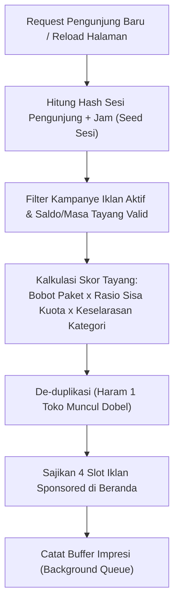
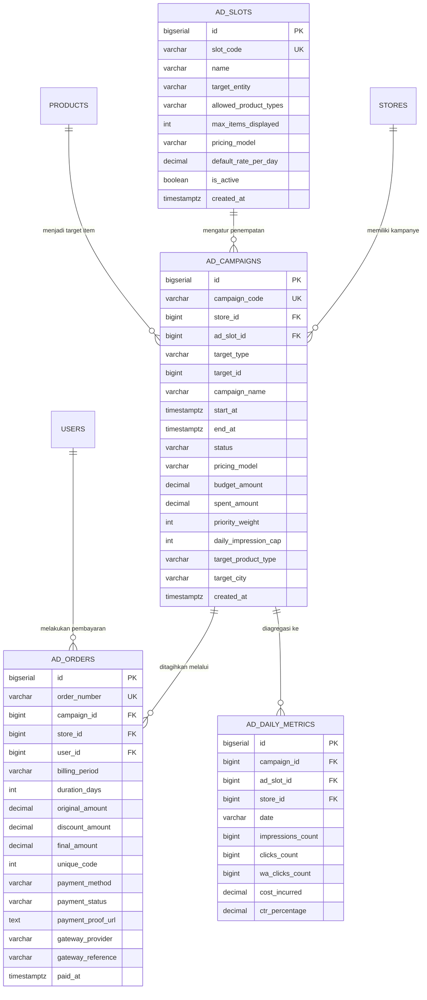
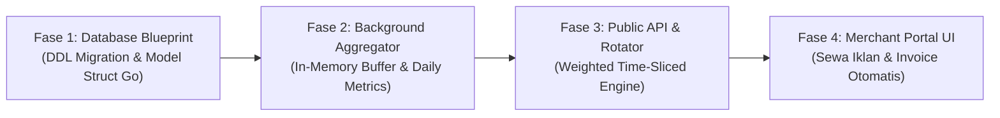

# CATAVOR ARCHITECTURAL SPECIFICATION: AD PLACEMENTS & POPULAR CATALOG SHOWCASE

**Dokumen**: Arsitektur & Spesifikasi Sistem Masa Depan  
**Platform**: Catavor Enterprise Multi-Tenant SaaS  
**Klasifikasi**: Internal Engineering Specification & Database Blueprint  
**Status**: Draf Arsitektural Terverifikasi (Siap Implementasi Bertahap)  

---

## DAFTAR ISI
1. [Ringkasan Eksekutif & Telaah Visi Arsitektur](#1-ringkasan-eksekutif--telaah-visi-arsitektur)
2. [Audit Kondisi Sistem & Skema Database Saat Ini](#2-audit-kondisi-sistem--skema-database-saat-ini)
3. [Studi Komparasi Industri & Riset Algoritma Rotasi Iklan](#3-studi-komparasi-industri--riset-algoritma-rotasi-iklan)
4. [Perancangan Struktur Database Masa Depan (1NF, 2NF, 3NF & Controlled Denormalization)](#4-perancangan-struktur-database-masa-depan-1nf-2nf-3nf--controlled-denormalization)
5. [Strategi High-Throughput & Pencegahan Database Lock Contention](#5-strategi-high-throughput--pencegahan-database-lock-contention)
6. [Arsitektur Query & Algoritma Penyajian Data Landing Page](#6-arsitektur-query--algoritma-penyajian-data-landing-page)
7. [Pelabelan Transparansi, Kepatuhan Etika & Graceful Degradation](#7-pelabelan-transparansi-kepatuhan-etika--graceful-degradation)
8. [Roadmap Implementasi Bertahap (Zero-Downtime Migration)](#8-roadmap-implementasi-bertahap-zero-downtime-migration)

---

## 1. RINGKASAN EKSEKUTIF & TELAAH VISI ARSITEKTUR

### 1.1. Latar Belakang & Visi Pengguna
Platform **Catavor** dirancang sebagai ekosistem *Multi-Tenant SaaS Digital Catalog & Biolink Commerce* yang melayani berbagai sektor usaha (7 format: barang fisik, kuliner, digital, jasa, hewan/fauna, tanaman, dan properti). 

Seiring perkembangan ekosistem, halaman muka (*Landing Page / Public Portal*) memiliki peran ganda:
1. **Showcase Aktivitas Pengunjung Riil (Organic Popularity Engine)**: Menampilkan katalog dan produk yang sedang tren, paling banyak dikunjungi, atau paling sering memicu interaksi pesanan WhatsApp/Rekber oleh calon pembeli.
2. **Komersialisasi & Monetisasi Ruang Promosi (Paid Sponsored Placements)**: Memberikan kesempatan bagi pemilik toko (*merchants*) untuk menyewa slot visibilitas premium di halaman pertama landing page, baik untuk mempromosikan **Profil Toko (Katalog Toko)** maupun **Item Produk Spesifik**.

### 1.2. Tantangan Inti yang Diidentifikasi
Pengguna secara kritis menanyakan:
> *"Kalau banyak yang menyewa iklan, saya mau konsepnya random. Tidak selalu profil toko yang bayar lebih dulu terus-menerus nangkring di urutan pertama tanpa tergantikan. Apakah best practice-nya cukup random murni, atau mempertahankan posisi tersebut, atau ada pendekatan lain?"*

Menjawab hal tersebut, laporan ini membedah:
- Mengapa **Pure Random (Acak Buta)** justru merugikan platform dan memicu komplain pengiklan.
- Mengapa **Static FIFO (Siapa Cepat Dia Menguasai)** membunuh minat pengiklan baru dan memicu *ad fatigue* bagi pengunjung.
- Mengapa **Weighted Time-Sliced Round-Robin (Rotasi Berbobot Berbasis Waktu & Sesi)** adalah standar baku industri e-commerce modern (Tokopedia, Shopee, Amazon, Google Ads).
- Menyiapkan **struktur tabel database yang kokoh, ternormalisasi, dan memenuhi kaidah ACID & controlled denormalization** sejak dini, sehingga saat modul periklanan diimplementasikan nanti, backend tidak memerlukan perombakan skema destruktif.

---

## 2. AUDIT KONDISI SISTEM & SKEMA DATABASE SAAT INI

Berdasarkan audit mendalam terhadap basis kode Catavor (`backend/internal/models`, `handlers`, dan `database`):

### 2.1. Entitas & Kolom Eksisting yang Relevan

```
+---------------------------------------------------------------------------------------------------+
| MODEL EKSISTING      | ATRIBUT METRIK & STATUS AKTUAL                                            |
+----------------------+----------------------------------------------------------------------------+
| models.Store         | - is_featured (BOOLEAN, saat ini diatur manual/kurasi admin)              |
|                      | - view_count, total_actions_count (BIGINT, akumulasi view/klik)            |
|                      | - plan ('free', 'pro_starter', 'pro_business')                            |
|                      | - primary_product_type (sektor industri spesifik)                         |
+----------------------+----------------------------------------------------------------------------+
| models.Product       | - view_count, popularity_score (BIGINT)                                   |
|                      | - wa_clicks_count, rekber_clicks_count, video_views_count (BIGINT)         |
|                      | - product_type, moderation_status, is_active                              |
+----------------------+----------------------------------------------------------------------------+
| models.StoreDaily-   | - date (YYYY-MM-DD), store_views, wa_clicks, direct_wa_clicks,            |
| Analytics            |   marketplace_clicks, rekber_clicks, video_views, total_actions           |
+----------------------+----------------------------------------------------------------------------+
| models.ProductDaily- | - product_id, date, views, wa_clicks, direct_wa_clicks, rekber_clicks,     |
| Analytics            |   total_actions                                                           |
+----------------------+----------------------------------------------------------------------------+
| models.Search-       | - keyword, clean_keyword, category_slug, product_type, is_zero_result     |
| Analytics / Rollup   | - search_volume, zero_result_count, clicked_product_count, ctr_percentage  |
+----------------------+----------------------------------------------------------------------------+
| models.Subscription- | - order_number, store_id, user_id, plan_code, billing_cycle               |
| Order                | - original_amount, discount_amount, final_amount, unique_code             |
|                      | - payment_status ('pending', 'paid', 'rejected', 'expired')                |
|                      | - gateway_provider ('aulaa'), payment_proof_url (manual transfer)         |
+----------------------+----------------------------------------------------------------------------+
```

### 2.2. Pola Query Landing Page Saat Ini
1. **Endpoint Toko Unggulan (`/api/stores/featured`)**:
   - Query saat ini:
     ```sql
     SELECT * FROM stores 
     WHERE dormancy_status NOT IN ('suspended', 'banned', 'purged') 
       AND is_blacklisted = false
     ORDER BY stores.is_featured DESC, stores.view_count DESC, stores.total_actions_count DESC, stores.created_at DESC
     LIMIT 12;
     ```
   - **Kelemahan**: Toko dengan `is_featured = true` dan `view_count` tertinggi akan selalu memonopoli 3 posisi teratas tanpa rotasi. Toko baru atau toko yang membayar belakangan tidak akan pernah tampak di layar pertama tanpa aksi *scroll* jauh.
2. **Endpoint Produk (`/api/products?sort=popular`)**:
   - Query saat ini:
     ```sql
     ORDER BY products.popularity_score DESC, products.view_count DESC, products.id DESC
     ```
   - **Kelemahan & Analisa Masalah**: Menghasilkan daftar statis untuk pengunjung karena menggunakan akumulator seumur hidup (*all-time cumulative*). Produk yang sudah terlanjur memiliki ribuan view di masa lalu akan selalu berada di atas (*the rich get richer phenomenon*), mengunci peluang produk baru yang sebenarnya sedang viral minggu ini.
   - **Solusi Tepat: Rolling Time-Window (7-Day / 14-Day Velocity Score)**:  
     Alih-alih memakai akumulasi seumur hidup, sistem memanfaatkan tabel **`product_daily_analytics`** dan **`store_daily_analytics`** yang *SUDAH ADA* di Catavor untuk mengukur aktivitas pengunjung dalam rentang **7 s/d 14 hari ke belakang**. Dengan bobot:
     $$\text{TrendingScore}_{7D} = \sum_{\text{7 hari terakhir}} \Big( (\text{Views} \times 1) + (\text{DirectWA} \times 5) + (\text{RekberClicks} \times 10) \Big)$$
     - **Efek bagi Produk Lama**: Jika produk lama sepi interaksi dalam 7 hari terakhir, skornya meluruh mendekati 0 sehingga posisinya turun secara alami.
     - **Efek bagi Produk Baru**: Produk baru yang ramai pesanan 3 hari terakhir akan memiliki skor tinggi dan **langsung melesat ke jajaran terpopuler**, menjaga etalase landing page selalu segar, adil, dan dinamis.

### 2.3. Identifikasi Gap Arsitektur
1. **Belum Ada Pemisahan Antara Organik vs Iklan**: Jika toko atau produk berbayar hanya diberi flag `is_featured = true`, data analitik organik akan terdistorsi (tidak bisa membedakan mana pengunjung yang datang karena rekomendasi murni vs akibat dorongan iklan berbayar).
2. **Ketiadaan Konsep Masa Berlaku Iklan (*Campaign Lifecycle*)**: Saat ini `is_featured` bersifat permanen hingga diubah manual oleh admin. Tidak ada otomatisasi masa aktif (misal sewa slot 3 hari, 7 hari, atau 30 hari).
3. **Ketiadaan Tracking Impresi Iklan (*Impression vs Conversion*)**: Pengiklan membutuhkan transparansi laporan: *"Berapa kali profil/item saya tampil di layar pengunjung (impresi) dan berapa kali tombol WhatsApp saya diklik dari slot tersebut?"*.
4. **Belum Ada Kuota / Kapasitas Slot (*Slot Inventory*)**: Berapa jumlah maksimal iklan yang boleh tayang bersamaan agar landing page tidak dipenuhi iklan yang merusak estetika dan pengalaman pengunjung (*ad clutter*).

---

## 3. STUDI KOMPARASI INDUSTRI & RISET ALGORITMA ROTASI IKLAN

Menjawab pertanyaan pengguna mengenai **apakah cukup acak (pure random) atau mempertahankan posisi awal**:

### 3.1. Analisis 4 Paradigma Penempatan Iklan

```
+----------------------------------------------------------------------------------------------------+
| PARADIGMA              | CARA KERJA                   | DAMPAK PENGUNJUNG     | DAMPAK PENGIKLAN   |
+------------------------+------------------------------+-----------------------+--------------------+
| 1. Pure Random         | ORDER BY RANDOM() pada       | Tampilan tidak stabil;| Merchant komplain: |
|    (Acak Murni)        | setiap request browser.      | tidak ada relevansi   | tidak ada jaminan  |
|                        |                              | kualitas produk.      | jatah impresi adil.|
+------------------------+------------------------------+-----------------------+--------------------+
| 2. Static FIFO         | Siapa bayar duluan/termahal  | Jenuh (Banner         | Monopoli slot;     |
|    (Monopoli Posisi)   | mengunci posisi 1-3          | Blindness) karena     | merchant baru rugi |
|                        | tanpa perubahan.             | kontennya itu-itu saja| dan enggan bayar.  |
+------------------------+------------------------------+-----------------------+--------------------+
| 3. Round-Robin Statis  | Urutan berputar ketat        | Tertebak;             | Adil waktu, tapi   |
|    (Giliran Jam)       | (Toko A -> B -> C -> A)      | tidak menghitung      | abaikan perbedaan  |
|                        | berdasarkan interval waktu.  | segmen industri user. | nilai paket sewa.  |
+------------------------+------------------------------+-----------------------+--------------------+
| 4. Weighted Time-Slice | Menggabungkan kuota tayang   | Variatif, dinamis,    | Adil, transparan,  |
|    Round-Robin         | berbobot + rotasi sesi +     | relevan dengan tipe   | impresi merata,    |
|    (STANDAR INDUSTRI)  | de-duplikasi visual.         | industri yang dicari. | ROI terukur jelas. |
+------------------------+------------------------------+-----------------------+--------------------+
```

### 3.2. Mengapa "Pure Random" Kurang Tepat untuk Iklan Berbayar?
Dalam rekayasa sistem periklanan (*Ad-Tech*), fungsi acak buta (`RANDOM()` / `Math.random()`) memiliki cacat fatal:
1. **Fluktuasi Statistik Ekstrem (Variance Problem)**: Secara acak murni, Toko A bisa saja muncul 100 kali dalam 1 jam, sedangkan Toko B (yang membayar biaya yang sama persis) hanya muncul 10 kali. Ini memicu sengketa bisnis dan tuduhan kecurangan sistem.
2. **Cold-Start & Clumping Effect**: Peluang acak murni bisa memunculkan produk yang sama di 3 slot bersebelahan pada halaman yang sama jika query tidak memiliki kontrol de-duplikasi.
3. **Ketidakmampuan Mengakomodasi Paket Sewa Berbeda**: Jika Merchant A membayar paket "Premium Showcase Rp 200rb" dan Merchant B membayar paket "Basic Banner Rp 50rb", fungsi acak murni memberikan probabilitas yang sama persis (50:50), yang melanggar janji nilai komersial.

### 3.3. Standar Solusi Industri: Weighted Time-Sliced Round-Robin with Session Seed

Pendekatan terbaik yang diterapkan oleh marketplace modern (seperti Tokopedia TopAds, Shopee Iklan, dan Etsy Promoted Listings pada slot beranda) adalah perpaduan **3 Komponen Harmonis**:



#### Komponen 1: Fair-Share Rotation (Anti-Monopoli)
Slot iklan dipecah menjadi beberapa posisi visual (misal Slot 1, Slot 2, Slot 3, Slot 4). Tidak ada satu toko pun yang diizinkan menempati Slot 1 secara permanen. Algoritma melakukan pergeseran posisi (*circular shift*) secara berkala (misal setiap pergantian sesi pengunjung unik atau interval 10–15 menit). Pengunjung X melihat Toko A di Slot 1, sementara Pengunjung Y melihat Toko B di Slot 1.

#### Komponen 2: Dynamic Delivery Pacing (Pemerataan Tayang Harian)
Mencegah sebuah kampanye iklan menghabiskan seluruh jatah impresi pada pagi hari (pukul 08:00–10:00) dan hilang sama sekali pada sore atau malam hari. Sistem menyebarkan peluang tayang secara merata sepanjang 24 jam.

#### Komponen 3: Session-Deterministic Shuffling (Pengalaman Pengunjung yang Mulus)
Jika pengunjung menekan tombol *Back* atau membuka tab baru dalam sesi yang sama selama 5 menit, susunan katalog tidak berubah-ubah secara liar di depan matanya. Namun saat sesi baru atau interval waktu berganti, urutan akan teracak secara elegan dengan daftar toko aktif lainnya.

---

## 4. PERANCANGAN STRUKTUR DATABASE MASA DEPAN (1NF, 2NF, 3NF & CONTROLLED DENORMALIZATION)

Sesuai aturan ketat [.agents/rules/02_database_architecture.md](file:///c:/MyProject/DFauna/.agents/rules/02_database_architecture.md):
- Nilai atomik (1NF), dependensi penuh pada primary key (2NF), dan eliminasi transitif (3NF).
- Dilarang keras memakai tipe data `FLOAT` atau `DOUBLE` untuk nilai uang (wajib `DECIMAL(15,2)`).
- Timestamp selalu UTC dengan zona waktu (`TIMESTAMPTZ`).
- Foreign keys terindeks dan dilengkapi *referential integrity* yang ketat.
- *Controlled Denormalization* diterapkan pada entitas faktur/transaksi iklan agar perubahan tarif di masa depan tidak mengubah historis pembayaran masa lalu.

### 4.1. Entity-Relationship Diagram (ERD)



---

### 4.2. Definisi Skema Tabel Relasional (PostgreSQL DDL)

#### Tabel 1: `ad_slots` (Master Tempat & Posisi Iklan)
Tabel ini mendefinisikan lokasi fisik tampilan di landing page atau sub-halaman, batas item yang boleh tampil bersamaan, dan aturan tarif dasarnya.

```sql
CREATE TABLE IF NOT EXISTS ad_slots (
    id BIGSERIAL PRIMARY KEY,
    slot_code VARCHAR(100) NOT NULL,
    name VARCHAR(255) NOT NULL,
    description TEXT,
    target_entity VARCHAR(50) NOT NULL DEFAULT 'store', -- 'store' | 'product' | 'mixed'
    allowed_product_types VARCHAR(255) NOT NULL DEFAULT 'all', -- 'all' atau 'food,physical,service'
    max_items_displayed INT NOT NULL DEFAULT 4, -- Jumlah kartu yang tampil simultan di satu baris/grid
    pricing_model VARCHAR(50) NOT NULL DEFAULT 'flat_daily', -- 'flat_daily' | 'cpm' (per 1000 impresi) | 'cpc'
    default_rate_per_day DECIMAL(15, 2) NOT NULL DEFAULT 0.00, -- Format Rupiah presisi tanpa floating loss
    min_duration_days INT NOT NULL DEFAULT 1,
    is_active BOOLEAN NOT NULL DEFAULT TRUE,
    created_at TIMESTAMP WITH TIME ZONE NOT NULL DEFAULT CURRENT_TIMESTAMP,
    updated_at TIMESTAMP WITH TIME ZONE NOT NULL DEFAULT CURRENT_TIMESTAMP,
    CONSTRAINT uq_ad_slots_code UNIQUE (slot_code)
);

CREATE INDEX IF NOT EXISTS idx_ad_slots_active ON ad_slots(is_active);
CREATE INDEX IF NOT EXISTS idx_ad_slots_entity ON ad_slots(target_entity);
```

---

#### Tabel 2: `ad_campaigns` (Kampanye Sewa Iklan Merchant)
Menyimpan kontrak sewa promosi dari merchant, objek yang dipromosikan (**Toko/Profil Katalog SAJA** atau **Item Produk Tertentu SAJA**), rentang tanggal aktif, dan bobot prioritas rotasi.

> [!IMPORTANT]
> **Integritas Relasional Ganda (Enforced Dual Foreign Keys)**:  
> Untuk mencegah *orphan records* dan mendukung pemisahan tegas antara iklan **Profil Toko** vs **Item Produk**, tabel ini menyediakan foreign key langsung ke `stores(id)` DAN `products(id)` dengan `CHECK CONSTRAINT` di level database PostgreSQL. Jika sebuah produk dihapus oleh merchant, iklan produk tersebut otomatis dibersihkan (`ON DELETE CASCADE`) tanpa merusak data profil toko.

```sql
CREATE TABLE IF NOT EXISTS ad_campaigns (
    id BIGSERIAL PRIMARY KEY,
    campaign_code VARCHAR(100) NOT NULL,
    store_id BIGINT NOT NULL, -- Merchant pemilik/pembayar kampanye iklan
    ad_slot_id BIGINT NOT NULL, -- Slot lokasi penempatan iklan
    
    -- Pemisahan Tegas Objek Iklan: 'store' (hanya profil) ATAU 'product' (hanya item)
    target_type VARCHAR(50) NOT NULL DEFAULT 'store', -- 'store' | 'product'
    target_store_id BIGINT DEFAULT NULL, -- Terisi HANYA jika target_type = 'store'
    target_product_id BIGINT DEFAULT NULL, -- Terisi HANYA jika target_type = 'product'
    target_id BIGINT NOT NULL, -- ID entitas target (penyederhanaan kueri polymorphic)
    
    campaign_name VARCHAR(255) NOT NULL,
    start_at TIMESTAMP WITH TIME ZONE NOT NULL,
    end_at TIMESTAMP WITH TIME ZONE NOT NULL,
    status VARCHAR(50) NOT NULL DEFAULT 'pending_payment', 
    -- 'draft' | 'pending_payment' | 'active' | 'paused' | 'completed' | 'cancelled' | 'rejected'
    pricing_model VARCHAR(50) NOT NULL DEFAULT 'flat_daily',
    budget_amount DECIMAL(15, 2) NOT NULL DEFAULT 0.00,
    spent_amount DECIMAL(15, 2) NOT NULL DEFAULT 0.00,
    priority_weight INT NOT NULL DEFAULT 10, -- Bobot probabilistik (misal 10=standar, 20=prioritas tinggi)
    daily_impression_cap INT NOT NULL DEFAULT 0, -- 0 = tanpa batas harian (pacing bebas)
    
    -- Filter Relevansi Sektor Industri (7 Tipe Katalog: food, physical, fauna, plant, service, digital, property, all)
    target_product_type VARCHAR(50) NOT NULL DEFAULT 'all', 
    target_city VARCHAR(100) DEFAULT NULL, -- Geotargeting opsional (misal Jakarta, Bandung, dll)
    custom_badge_text VARCHAR(50) DEFAULT 'Disponsori', -- Label teks penanda iklan
    rejection_reason TEXT DEFAULT NULL,
    approved_by_user_id BIGINT DEFAULT NULL,
    approved_at TIMESTAMP WITH TIME ZONE DEFAULT NULL,
    created_at TIMESTAMP WITH TIME ZONE NOT NULL DEFAULT CURRENT_TIMESTAMP,
    updated_at TIMESTAMP WITH TIME ZONE NOT NULL DEFAULT CURRENT_TIMESTAMP,
    deleted_at TIMESTAMP WITH TIME ZONE DEFAULT NULL,

    CONSTRAINT uq_ad_campaigns_code UNIQUE (campaign_code),
    CONSTRAINT fk_ad_campaigns_store FOREIGN KEY (store_id) REFERENCES stores(id) ON DELETE CASCADE,
    CONSTRAINT fk_ad_campaigns_slot FOREIGN KEY (ad_slot_id) REFERENCES ad_slots(id) ON DELETE RESTRICT,
    CONSTRAINT fk_ad_campaigns_target_store FOREIGN KEY (target_store_id) REFERENCES stores(id) ON DELETE CASCADE,
    CONSTRAINT fk_ad_campaigns_target_product FOREIGN KEY (target_product_id) REFERENCES products(id) ON DELETE CASCADE,
    CONSTRAINT fk_ad_campaigns_approver FOREIGN KEY (approved_by_user_id) REFERENCES users(id) ON DELETE SET NULL,
    CONSTRAINT chk_ad_campaigns_dates CHECK (end_at > start_at),
    -- Memastikan integritas atomik: Jika tipe 'store', target_store_id WAJIB ada dan target_product_id NULL.
    -- Jika tipe 'product', target_product_id WAJIB ada.
    CONSTRAINT chk_ad_campaigns_target_integrity CHECK (
        (target_type = 'store' AND target_store_id IS NOT NULL AND target_product_id IS NULL) OR
        (target_type = 'product' AND target_product_id IS NOT NULL)
    )
);

-- Indeks komposit vital untuk performa rotasi iklan (SARGable query)
CREATE INDEX IF NOT EXISTS idx_ad_campaigns_active_rotation 
ON ad_campaigns (ad_slot_id, status, start_at, end_at, priority_weight) 
WHERE deleted_at IS NULL AND status = 'active';

CREATE INDEX IF NOT EXISTS idx_ad_campaigns_store ON ad_campaigns(store_id);
CREATE INDEX IF NOT EXISTS idx_ad_campaigns_target_store ON ad_campaigns(target_store_id) WHERE target_store_id IS NOT NULL;
CREATE INDEX IF NOT EXISTS idx_ad_campaigns_target_prod ON ad_campaigns(target_product_id) WHERE target_product_id IS NOT NULL;
CREATE INDEX IF NOT EXISTS idx_ad_campaigns_prod_type ON ad_campaigns(target_product_type);
CREATE INDEX IF NOT EXISTS idx_ad_campaigns_dates ON ad_campaigns(start_at, end_at);
```

---

#### Tabel 3: `ad_orders` (Faktur & Transaksi Pembayaran Iklan)
Menerapkan **Controlled Denormalization** ketat: Menyimpan snapshot harga, tarif, dan durasi saat transaksi terjadi agar mutasi harga di tabel `ad_slots` di kemudian hari tidak mengubah pembukuan historis.

```sql
CREATE TABLE IF NOT EXISTS ad_orders (
    id BIGSERIAL PRIMARY KEY,
    order_number VARCHAR(100) NOT NULL, -- Misal: 'INV-AD-20261105-0012'
    campaign_id BIGINT NOT NULL,
    store_id BIGINT NOT NULL,
    user_id BIGINT NOT NULL,
    
    -- Snapshot historis finansial (Wajib non-float & kekal)
    slot_name_snapshot VARCHAR(255) NOT NULL,
    pricing_model_snapshot VARCHAR(50) NOT NULL,
    duration_days INT NOT NULL DEFAULT 1,
    original_amount DECIMAL(15, 2) NOT NULL DEFAULT 0.00,
    discount_amount DECIMAL(15, 2) NOT NULL DEFAULT 0.00,
    final_amount DECIMAL(15, 2) NOT NULL DEFAULT 0.00,
    coupon_code VARCHAR(100) DEFAULT NULL,
    unique_code INT NOT NULL DEFAULT 0, -- 3 digit unik verifikasi transfer manual
    
    payment_method VARCHAR(50) NOT NULL DEFAULT 'bank_transfer', -- 'bank_transfer' | 'qris' | 'balance'
    payment_status VARCHAR(50) NOT NULL DEFAULT 'pending', 
    -- 'pending' | 'pending_verification' | 'paid' | 'rejected' | 'expired' | 'refunded'
    
    sender_account_name VARCHAR(150) DEFAULT NULL,
    sender_bank_name VARCHAR(100) DEFAULT NULL,
    payment_proof_url TEXT DEFAULT NULL, -- Menunjuk ke storage privat
    
    gateway_provider VARCHAR(50) DEFAULT NULL, -- 'aulaa'
    gateway_reference VARCHAR(150) DEFAULT NULL,
    gateway_payment_link TEXT DEFAULT NULL,
    gateway_raw_response JSONB DEFAULT NULL,
    
    rejection_reason TEXT DEFAULT NULL,
    approved_by_user_id BIGINT DEFAULT NULL,
    expires_at TIMESTAMP WITH TIME ZONE DEFAULT NULL,
    paid_at TIMESTAMP WITH TIME ZONE DEFAULT NULL,
    created_at TIMESTAMP WITH TIME ZONE NOT NULL DEFAULT CURRENT_TIMESTAMP,
    updated_at TIMESTAMP WITH TIME ZONE NOT NULL DEFAULT CURRENT_TIMESTAMP,

    CONSTRAINT uq_ad_orders_number UNIQUE (order_number),
    CONSTRAINT fk_ad_orders_campaign FOREIGN KEY (campaign_id) REFERENCES ad_campaigns(id) ON DELETE CASCADE,
    CONSTRAINT fk_ad_orders_store FOREIGN KEY (store_id) REFERENCES stores(id) ON DELETE CASCADE,
    CONSTRAINT fk_ad_orders_user FOREIGN KEY (user_id) REFERENCES users(id) ON DELETE RESTRICT,
    CONSTRAINT fk_ad_orders_approver FOREIGN KEY (approved_by_user_id) REFERENCES users(id) ON DELETE SET NULL
);

CREATE INDEX IF NOT EXISTS idx_ad_orders_campaign ON ad_orders(campaign_id);
CREATE INDEX IF NOT EXISTS idx_ad_orders_store ON ad_orders(store_id);
CREATE INDEX IF NOT EXISTS idx_ad_orders_status ON ad_orders(payment_status);
CREATE INDEX IF NOT EXISTS idx_ad_orders_created ON ad_orders(created_at DESC);
```

---

#### Tabel 4: `ad_daily_metrics` (Agregasi Performa Iklan Harian)
Menyimpan ringkasan impresi dan klik per hari per kampanye. Menjamin data iklan terisolasi penuh dari analitik organik toko, sehingga merchant dapat mengevaluasi efektivitas biaya (*Return on Ad Spend / ROAS*).

```sql
CREATE TABLE IF NOT EXISTS ad_daily_metrics (
    id BIGSERIAL PRIMARY KEY,
    campaign_id BIGINT NOT NULL,
    ad_slot_id BIGINT NOT NULL,
    store_id BIGINT NOT NULL,
    date VARCHAR(10) NOT NULL, -- Format YYYY-MM-DD (konsisten dengan StoreDailyAnalytics)
    impressions_count BIGINT NOT NULL DEFAULT 0,
    clicks_count BIGINT NOT NULL DEFAULT 0,
    wa_clicks_count BIGINT NOT NULL DEFAULT 0,
    cost_incurred DECIMAL(15, 2) NOT NULL DEFAULT 0.00,
    ctr_percentage DECIMAL(5, 2) NOT NULL DEFAULT 0.00, -- (clicks_count / impressions_count) * 100
    created_at TIMESTAMP WITH TIME ZONE NOT NULL DEFAULT CURRENT_TIMESTAMP,
    updated_at TIMESTAMP WITH TIME ZONE NOT NULL DEFAULT CURRENT_TIMESTAMP,

    CONSTRAINT uq_ad_daily_metrics_camp_date UNIQUE (campaign_id, date),
    CONSTRAINT fk_ad_metrics_campaign FOREIGN KEY (campaign_id) REFERENCES ad_campaigns(id) ON DELETE CASCADE,
    CONSTRAINT fk_ad_metrics_slot FOREIGN KEY (ad_slot_id) REFERENCES ad_slots(id) ON DELETE CASCADE,
    CONSTRAINT fk_ad_metrics_store FOREIGN KEY (store_id) REFERENCES stores(id) ON DELETE CASCADE
);

CREATE INDEX IF NOT EXISTS idx_ad_daily_metrics_store_date ON ad_daily_metrics(store_id, date);
CREATE INDEX IF NOT EXISTS idx_ad_daily_metrics_slot_date ON ad_daily_metrics(ad_slot_id, date);
```

---

## 5. STRATEGI HIGH-THROUGHPUT & PENCEGAHAN DATABASE LOCK CONTENTION

### 5.1. Masalah Fatal: Row-Locking pada Direct Impression Update
Jika setiap kali ribuan pengunjung membuka landing page sistem langsung menjalankan:
```sql
-- DILARANG PADA TRAFIK TINGGI (ANTI-PATTERN):
UPDATE ad_daily_metrics 
SET impressions_count = impressions_count + 1 
WHERE campaign_id = 12 AND date = '2026-11-05';
```
PostgreSQL akan mengunci baris tersebut (*Row Exclusive Lock*). Akibatnya, request pengunjung lain akan mengantre (*lock contention*), latensi landing page melonjak dari 15ms menjadi 2.000ms+ (*spike timeout*), dan server Go berisiko mengalami *socket exhaustion*.

### 5.2. Solusi Industri: In-Memory / Redis Atomic Accumulator dengan Background Flusher
Catavor telah memiliki infrastruktur Redis dengan graceful fallback in-memory (lihat `backend/internal/database/redis.go`).

```
Pengunjung Buka Landing Page
          │
          ▼
Catat Impresi ke In-Memory / Redis Ring Buffer (Atomic INCR)
(Waktu Eksekusi: < 0.2 milidetik — Zero Database Locks)
          │
          ▼
Background Worker (Berjalan tiap 60 detik)
Mengambil buffer akumulasi dan mengeksekusi BATCH UPSERT tunggal:
          │
          ▼
INSERT INTO ad_daily_metrics (campaign_id, ad_slot_id, store_id, date, impressions_count)
VALUES 
  (12, 1, 45, '2026-11-05', 340),
  (15, 1, 88, '2026-11-05', 315)
ON CONFLICT (campaign_id, date) 
DO UPDATE SET 
  impressions_count = ad_daily_metrics.impressions_count + EXCLUDED.impressions_count,
  updated_at = CURRENT_TIMESTAMP;
```

---

## 6. ARSITEKTUR QUERY & ALGORITMA PENYAJIAN DATA LANDING PAGE

### 6.1. Algoritma Rotasi Dinamis Berbobot (Weighted Time-Slice Shuffle)

Untuk menghasilkan perilaku **"Adil, Acak Proporsional, dan Bergantian"** sebagaimana diinginkan pengguna:

#### Langkah 1: Kueri Kandidat Kampanye yang Valid (Fast Index Lookup)
Ambil seluruh kampanye yang berstatus `active`, dalam jendela waktu `NOW()`, dan belum melampaui batas harian:
```sql
SELECT 
    c.id, c.campaign_code, c.store_id, c.target_type, c.target_id, 
    c.priority_weight, c.custom_badge_text,
    s.slug AS store_slug, s.store_title, s.store_logo_url, s.store_slogan, s.store_theme,
    p.id AS product_id, p.name AS product_name, p.price AS product_price, p.image_url AS product_image
FROM ad_campaigns c
INNER JOIN stores s ON s.id = c.store_id
LEFT JOIN products p ON (c.target_type = 'product' AND p.id = c.target_id)
WHERE c.ad_slot_id = $1
  AND c.status = 'active'
  AND c.deleted_at IS NULL
  AND CURRENT_TIMESTAMP BETWEEN c.start_at AND c.end_at
  AND s.dormancy_status NOT IN ('suspended', 'banned', 'purged')
  AND s.is_blacklisted = FALSE;
```

#### Langkah 2: Shuffling Berbobot di Lapisan Go Backend (Weighted In-Memory Selection)
Di lapisan Go handler (bukan di SQL agar performa database tetap optimal):
1. **Hitung Seed Rotasi**:
   $$\text{SessionSeed} = \text{Hash}(\text{VisitorSessionID} + \text{JamAktifUTC})$$
   *Manfaat*: Setiap pengunjung dalam sesi yang sama mendapatkan tampilan stabil selama 1 jam, namun setiap pengunjung yang berbeda melihat susunan pengiklan yang bervariasi.
2. **Kalkulasi Bobot Dinamis**:
   Setiap kampanye $i$ memiliki probabilitas terpilih sebanding dengan bobotnya:
   $$\text{Score}_i = -\frac{\ln(U_i)}{\text{Weight}_i}$$
   *(di mana $U_i$ adalah angka acak seragam antara 0 dan 1 yang dihasilkan oleh generator pseudo-random beralas seed sesi)*.
3. **Penyortiran & De-duplikasi**:
   Urutkan kampanye berdasarkan $\text{Score}_i$ terendah. Ambil sejumlah $N$ item teratas (sesuai `max_items_displayed` slot).
   Jika sebuah toko memiliki 2 produk yang sama-sama beriklan di slot yang sama, hanya 1 item dengan skor tertinggi yang diizinkan tampil dalam satu tampilan (*strict store de-duplication*).

---

### 6.2. Integrasi Dual-Engine: Menggabungkan Iklan (Sponsored) & Organik Populer Layaknya Online Shop Modern

Landing page dirancang menghadirkan pengalaman visual layaknya marketplace enterprise (Tokopedia / Shopee / Amazon) dengan memisahkan secara tegas dan elegan antara promosi **Profil Toko** vs promosi **Item Produk Tertentu**:

```
+----------------------------------------------------------------------------------------------------+
| STRUKTUR SECTION BERANDA      | SUMBER DATA              | OBJEK TAMPILAN & PENGALAMAN PENGUNJUNG  |
+-------------------------------+--------------------------+-----------------------------------------+
| Section 1:                    | ad_campaigns (store) +   | KARTU PROFIL TOKO (STORE CARDS)         |
| "Katalog Toko Pilihan &       | stores.view_count &      | - Menampilkan logo, nama usaha, slogan, |
| Terpopuler"                   | total_actions_count      |   lencana verifikasi & tombol kunjungi. |
| (Carousel / 4-Grid Lebar)     | (Weighted Time-Sliced)   | - Merchant B yang hanya sewa profil     |
|                               |                          |   akan tampil di sini.                  |
+-------------------------------+--------------------------+-----------------------------------------+
| Section 2:                    | ad_campaigns (product) + | KARTU ITEM PRODUK (PRODUCT CARDS)       |
| "Flash Spotlight: Produk &    | products.popularity_score| - Menampilkan foto produk, nama, harga, |
| Layanan Unggulan Terlaris"    | (Aktivitas riil WA/order)|   nama toko pemilik & CTA pesan WA.     |
| (Multi-Column Grid)           |                          | - Merchant A yang hanya sewa 1 item     |
|                               |                          |   akan tampil di sini (bukan tokonya).  |
+-------------------------------+--------------------------+-----------------------------------------+
| Section 3:                    | Tab Filter Interaktif:   | ETALASE SPESIFIK 7 FORMAT KATALOG       |
| "Jelajahi Berdasarkan 7       | - ad_campaigns           | - Pengunjung memilih tab (misal Kuliner)|
| Spesialisasi Usaha"           |   (target_product_type)  |   -> Menampilkan item kuliner sponsored |
| (Interactive Segmented Tabs)  | - products.product_type  |   diikuti produk kuliner terpopuler     |
|                               |                          |   secara terarah dan terisolasi.        |
+-------------------------------+--------------------------+-----------------------------------------+
```

---

### 6.3. Analisa Skenario Kasus Nyata: Merchant A (Hanya Item) vs Merchant B (Hanya Profil Toko)

Arsitektur ini secara presisi menjawab dua kebutuhan operasional yang berbeda:

#### Kasus 1: Merchant A Hanya Ingin Mengiklankan 1 Item Spesifik (Misal: "Kopi Arabika Premium")
* **Kebutuhan**: Merchant A tidak ingin mempromosikan seluruh tokonya, melainkan sedang mengadakan cuci gudang atau meluncurkan produk *best-seller* tertentu.
* **Alur di Sistem**:
  1. Saat membuat kampanye di dashboard, Merchant A memilih:  
     `target_type = 'product'` $\rightarrow$ Memilih produk dari dropdown: `target_product_id = 412`.
  2. Sistem menetapkan `target_store_id = NULL` dan mengisi `target_product_type = 'food'`.
  3. **Hasil di Landing Page**:
     - Di **Section 2 (Flash Spotlight)** dan **Section 3 (Tab Kuliner)**, yang muncul adalah **Kartu Produk Kopi Arabika Premium** lengkap dengan foto resolusi tinggi, harga promo Rp 45.000, label *"Disponsori"*, dan badge toko kecil di sudut kartu.
     - Toko Merchant A **TIDAK** memakan tempat di Section 1 (Profil Toko), sehingga anggaran iklannya 100% fokus mengonversi penjualan produk tersebut.

#### Kasus 2: Merchant B Hanya Ingin Mengiklankan Profil Katalog Tokonya (Branding & Otoritas)
* **Kebutuhan**: Merchant B adalah distributor besar atau brand resmi yang ingin memperkuat citra usaha dan mengumpulkan *followers/visitors* ke biolink tokonya.
* **Alur di Sistem**:
  1. Merchant B memilih:  
     `target_type = 'store'` $\rightarrow$ Memilih toko: `target_store_id = 88`.
  2. Sistem menetapkan `target_product_id = NULL` dan mengisi `target_product_type = 'all'` (atau spesialisasi tokonya).
  3. **Hasil di Landing Page**:
     - Di **Section 1 (Katalog Pilihan Beranda)**, yang muncul adalah **Kartu Profil Bisnis** Merchant B: Banner toko, Logo resmi, Slogan, Jumlah produk aktif ("240 Produk"), dan tombol *"Kunjungi Katalog"*.
     - Item-item produk individu milik Merchant B tidak dipaksakan tampil di Section 2, kecuali produk tersebut secara organik memang sedang trending.

#### Kasus 3: Segmentasi 7 Tipe Katalog Tanpa Percampuran Liar
* Pengunjung yang membuka tab **Kuliner** di landing page tidak akan disuguhkan iklan reptil/fauna atau properti.
* Query SQL menggunakan filter SARGable:
  ```sql
  WHERE ad_slot_id = $slot_id 
    AND (target_product_type = $selected_tab OR target_product_type = 'all')
  ```
  Ini menjamin relevansi 100% antara minat pengunjung dan materi iklan yang disajikan.

---

## 7. PELABELAN TRANSPARANSI, KEPATUHAN ETIKA & GRACEFUL DEGRADATION

### 7.1. Etika & Transparansi Iklan
Sesuai pedoman etika periklanan digital (*FTC Guidelines* & standar perlindungan konsumen):
1. **Wajib Label Jelas**: Setiap kartu atau profil yang tampil dari hasil sewa iklan **WAJIB** memuat penanda badge yang jelas: `Disponsori` atau `Iklan` atau `Promosi`.
2. **Ikon Vektor Profesional**: Mengikuti aturan [.agents/rules/04_ui_ux_and_anti_ai_standards.md](file:///c:/MyProject/DFauna/.agents/rules/04_ui_ux_and_anti_ai_standards.md), dilarang menggunakan karakter emoji (seperti 🚀, 🔥, 📢) pada label iklan. Gunakan ikon vektor profesional seperti Lucide `Sparkles` atau `Megaphone` berukuran 12–14px dengan nuansa warna tenang (*subtle neutral slate/amber badge*).
3. **Pemisahan Jalur Klik**: Klik pada kartu iklan dicatat ke endpoint khusus (misal: `POST /api/public/ads/:campaign_id/click`) sebelum diarahkan ke katalog atau WhatsApp toko, tanpa mengorbankan kecepatan muat (*zero latency redirect*).

### 7.2. Prinsip Graceful Degradation (Anti-Layar Kosong)
Bagaimana jika pada awal peluncuran **belum ada merchant yang menyewa iklan**?
- **Sistem Dilarang Menampilkan Kotak Kosong atau Pesan Eror**:
  Jika jumlah kampanye iklan aktif untuk suatu slot bernilai 0 ($count = 0$), handler backend secara otomatis mengaktifkan mode **Fallback Organik**.
- Slot tersebut sementara diisi oleh katalog atau produk dengan skor aktivitas organik tertinggi (`view_count` dan `wa_clicks_count` tertinggi) dengan label badge diganti menjadi `Rekomendasi Komunitas` (bukan "Disponsori").
- Dengan cara ini, tampilan landing page selalu terisi penuh, padat, dan menarik bagi pengunjung baru.

---

## 8. AUDIT CELAH KEAMANAN (VULNERABILITY AUDIT) & PERTAHANAN MULTI-LAYER (DEFENSE-IN-DEPTH)

Penerapan sistem periklanan dan katalog populer di halaman publik membuka permukaan serangan (*attack surface*) baru yang dapat dimanfaatkan pihak tidak bertanggung jawab. Berikut adalah audit 6 celah keamanan kritis beserta arsitektur penangkalnya:

```
+----------------------------------------------------------------------------------------------------+
| VEKTOR SERANGAN               | DAMPAK RISIKO                | STRATEGI PERTAHANAN MULTI-LAYER    |
+-------------------------------+------------------------------+------------------------------------+
| 1. Click Fraud &              | Saldo iklan kompetitor kuras;| Token bucket per IP & sesi unik;   |
|    Impression Flooding        | kuota tayang harian habis    | HMAC-signed click URL 60s;         |
|                               | tanpa konversi riil.         | filter botnet & headless browser.  |
+-------------------------------+------------------------------+------------------------------------+
| 2. Gaming Organic Popularity  | Produk sampah/spam           | Deduplikasi sesi 24 jam;           |
|    (Manipulasi Skor Tren)     | memanipulasi trending        | deteksi lonjakan anomali (spike);  |
|                               | via bot traffic.             | bobot tinggi pada transaksi riil.  |
+-------------------------------+------------------------------+------------------------------------+
| 3. IDOR & Cross-Tenant        | Merchant A mengiklankan      | Validasi kepemilikan multi-tenant; |
|    Hijacking                  | produk milik Toko B;         | verifikasi relasi store-product;   |
|                               | manipulasi kampanye orang.   | blokir toko status banned/suspend. |
+-------------------------------+------------------------------+------------------------------------+
| 4. Financial Tampering &      | Sewa slot gratis via ubah    | Kalkulasi harga 100% server-side;  |
|    Payment Race Condition     | nominal; dobel approval      | SELECT FOR UPDATE transaksi SQL;   |
|                               | via race condition; shell.   | magic-byte image validation.       |
+-------------------------------+------------------------------+------------------------------------+
| 5. Ad Cloaking &              | Lolos approval produk legal, | Freeze mode pasca-approval:        |
|    Bait-and-Switch            | lalu diubah jadi judi/scam   | edit produk aktif otomatis memicu  |
|                               | saat iklan sudah tayang.     | status 'in_review' & copot iklan.  |
+-------------------------------+------------------------------+------------------------------------+
| 6. Open Redirect & Malicious  | Link iklan mengarah ke       | Whitelist protokol HTTPS;          |
|    Scheme Injection           | phishing / skrip XSS         | integrasi modul safe_domains;      |
|                               | javascript:alert(1).         | regex sanitasi nomor WhatsApp.     |
+-------------------------------+------------------------------+------------------------------------+
```

---

### 8.1. Celah 1: Click Fraud & Impression Flooding (Pengurasan Anggaran Iklan Lawan)
* **Ancaman**: Kompetitor atau sindikat bot mengeklik iklan merchant lawan ribuan kali secara terprogram untuk menguras anggaran harian (*competitor budget draining*) atau melakukan spam refresh landing page agar slot iklan lawan cepat kedaluwarsa.
* **Solusi Rekayasa Pertahanan**:
  1. **IP & Session-Based Token Bucket Rate Limiting**:  
     Hanya 1 klik per alamat IP / Sesi Pengunjung Unik per 30 menit yang dihitung ke dalam penagihan (*cost incurred*) dan metrik analitik. Klik berulang dalam jendela waktu tersebut tetap dialihkan ke toko tujuan tetapi diberi flag `is_chargeable = false`.
  2. **HMAC-Signed Dynamic Click Tokens**:  
     Setiap kartu iklan di beranda menyertakan tautan redirect terenkripsi dengan HMAC-SHA256:
     ```
     /api/public/ads/click?c=CMP-0012&ts=1730800000&sig=a9f4c3...
     ```
     Token ini memiliki masa berlaku ketat (60 detik) dan sekali pakai (*single-use nonce*), mencegah bot melakukan *replay attack* menggunakan URL klik lama.
  3. **Bot & Crawler Auto-Exclusion**:  
     Request dengan User-Agent crawler/bot (Googlebot, Bingbot, curl, python-requests, Puppeteer tanpa flag) diidentifikasi pada lapisan middleware dan **100% dikecualikan** dari perhitungan impresi maupun pengurangan anggaran.

---

### 8.2. Celah 2: Gaming Organic Popularity (Manipulasi Skor Tren 7 Hari)
* **Ancaman**: Toko nakal menggunakan auto-clicker atau traffic generator murah untuk membanjiri `views` dan `wa_clicks` agar produknya menduduki peringkat teratas di section "Sedang Tren Minggu Ini" secara cuma-cuma.
* **Solusi Rekayasa Pertahanan**:
  1. **Deduplikasi Sesi 24 Jam**:  
     Satu sesi pengunjung unik hanya boleh menyumbangkan maksimal 1 poin view dan 1 poin klik per produk dalam rentang 24 jam.
  2. **Velocity Spike Anomaly Detection**:  
     Jika sebuah produk menerima lebih dari 100 klik dalam waktu kurang dari 60 detik dari subnet IP yang sama atau tanpa header `Referer` yang valid, sistem otomatis menandai produk tersebut dengan bendera `suspicious_velocity = true` dan mengunci skor tren sementaranya hingga diverifikasi background worker.
  3. **Proof-of-Intent Weighting**:  
     Skor popularitas memberikan bobot dominan pada aksi yang melibatkan komitmen riil pembeli:
     - Kunjungan halaman mentah: **Bobot 1**
     - Klik tombol pemesanan WhatsApp: **Bobot 5**
     - Inisiasi transaksi via Rekber Syariah: **Bobot 10**

---

### 8.3. Celah 3: Insecure Direct Object References (IDOR) & Pembajakan Iklan
* **Ancaman**: Merchant A mencoba mengiklankan produk milik Toko B (misal produk Toko B yang berperingkat buruk untuk dirusak reputasinya, atau membajak diskon toko lain), atau merchant nakal mencoba menghentikan/mengubah kampanye milik toko lain dengan mengubah parameter `campaign_id` di API.
* **Solusi Rekayasa Pertahanan**:
  1. **Validasi Kepemilikan Multi-Tenant Berlapis di Backend**:  
     Setiap pembuatan kampanye tipe produk wajib memverifikasi bahwa item tersebut sah milik toko penyewa:
     ```go
     var count int64
     db.Model(&models.Product{}).
         Where("id = ? AND store_id = ? AND is_active = true", req.TargetProductID, claims.StoreID).
         Count(&count)
     if count == 0 {
         return c.Status(fiber.StatusForbidden).JSON(fiber.Map{
             "success": false,
             "message": "Anda tidak memiliki hak otorisasi untuk mempromosikan produk ini.",
         })
     }
     ```
  2. **Integritas Status Akun Toko (Account Standing Gate)**:  
     Sistem secara otomatis menolak pembuatan iklan jika toko berada dalam status `dormancy_status IN ('suspended', 'banned', 'purged')` atau `is_blacklisted = true`. Jika sebuah toko terkena suspensi di kemudian hari, seluruh kampanye iklan aktifnya otomatis dibekukan saat itu juga (`status = 'paused'`).

---

### 8.4. Celah 4: Financial Tampering, Concurrency Race Conditions & Fake Proofs
* **Ancaman**: 
  - Merchant mencegat request dan mengubah nominal `final_amount` menjadi `Rp 1` di payload JSON.
  - Merchant mengirim 2 request verifikasi bukti bayar secara simultan (*race condition*) untuk memperpanjang durasi kampanye dua kali lipat.
  - Pengunggahan bukti transfer palsu berformat executable (`.php`, `.sh`, `.exe`) yang disamarkan sebagai gambar.
* **Solusi Rekayasa Pertahanan**:
  1. **Server-Side Price Calculation**:  
     Nilai transaksi `final_amount` **DILARANG KERAS** mempercayai data dari klien. Backend menghitung tarif secara independen:
     $$\text{FinalAmount} = (\text{TarifHarian} \times \text{DurasiHari}) - \text{DiskonKupon} + \text{KodeUnik}$$
  2. **Pencegahan Race Condition dengan Transaksional Mutex / Row Lock**:  
     Saat staf admin memverifikasi pembayaran bukti transfer, backend mengeksekusi `SELECT ... FOR UPDATE` dalam transaksi SQL atomik agar tidak terjadi *double-activation*.
  3. **Magic-Byte Binary Image Verification & Storage Isolation**:  
     Berkas bukti transfer wajib lolos verifikasi biner (bukan sekadar ekstensi file), metadata EXIF dibersihkan, dan file disimpan di direktori privat `storage/private/billing/` yang berada di luar jangkauan route publik `/storage`.

---

### 8.5. Celah 5: Ad Content Cloaking / Bait-and-Switch (Penyelundupan Konten Terlarang)
* **Ancaman**: Merchant mendaftarkan item yang sopan dan legal (misal: "Baju Kemeja Polos") untuk disetujui admin. Begitu iklan disetujui dan aktif di beranda, merchant langsung mengedit judul, foto, dan deskripsi menjadi konten judi online, penipuan, atau obat terlarang.
* **Solusi Rekayasa Pertahanan**:
  1. **Pola Freeze Pasca-Approval (Auto-Re-moderation)**:  
     Pada handler `ProductHandler.Update`, sistem memeriksa apakah produk tersebut sedang berstatus aktif di `ad_campaigns`. Jika ya:
     - Setiap pengubahan foto utama atau nama produk **secara otomatis mencopot penayangan iklan dari beranda**.
     - Status kampanye diubah kembali menjadi `in_review` dan memunculkan notifikasi ke admin konsol untuk ditinjau ulang.
  2. **Snapshot Data Penayangan Iklan**:  
     Data yang disajikan pada slot beranda dapat membaca snapshot judul dan foto saat disetujui, sehingga pengeditan liar di master produk tidak otomatis tembus ke landing page tanpa otorisasi.

---

### 8.6. Celah 6: Open Redirect, SSRF & Malicious Scheme Injection
* **Ancaman**: Pengiklan memasukkan tautan website atau nomor kontak yang disusupi skema berbahaya seperti `javascript:eval(...)`, `data:text/html...`, atau link jebakan phishing.
* **Solusi Rekayasa Pertahanan**:
  1. **Protokol Whitelist Ketat**:  
     Hanya skema `https://` yang diizinkan untuk tautan eksternal, dan wajib divalidasi silang terhadap daftar domain aman di tabel `safe_domains` Catavor.
  2. **Regex Sanitasi Nomor WhatsApp**:  
     Nomor kontak untuk tombol CTA WhatsApp wajib disanitasi menggunakan ekspresi reguler ketat `^[0-9]{9,15}$` sebelum dihubungkan ke `https://wa.me/`, mencegah injeksi parameter URL berbahaya.

---

## 9. ROADMAP IMPLEMENTASI BERTAHAP (ZERO-DOWNTIME MIGRATION)

Perubahan ini dirancang agar dapat dipersiapkan struktur database-nya sekarang tanpa mengganggu (*zero regression*) operasional sistem port 8000 yang sedang berjalan.



### Rincian Rencana Eksekusi:
1. **Fase 1 (Saat Ini / Persiapan Skema)**:
   - Buat file migrasi SQL terisolasi `20261105_create_advertising_tables.sql` di `backend/internal/database/migrations/`.
   - Buat Go struct models di `backend/internal/models/ad_placement.go` yang merefleksikan 4 tabel (`AdSlot`, `AdCampaign`, `AdOrder`, `AdDailyMetric`).
   - Karena server berjalan dengan `DB_AUTO_MIGRATE=false`, file migrasi ini aman dan tidak akan dieksekusi sebelum pengembang/admin secara sadar mengizinkan migrasi.
2. **Fase 2 (Engine Rotasi di Backend)**:
   - Bangun `AdService` dengan fungsi `GetRotatedCampaignsForSlot(slotCode string, limit int, sessionID string)`.
   - Hubungkan dengan endpoint landing page `/api/public/showcase/featured`.
3. **Fase 3 (Antarmuka Pengguna Frontend)**:
   - Terapkan section "Katalog Populer & Disponsori" pada antarmuka Desktop, Tablet, dan Mobile dengan mematuhi *Tri-Frontend Parity*.
   - Tambahkan tab "Sewa Promosi Beranda" pada Dashboard Merchant di bawah menu Pemasaran.
4. **Fase 4 (Integrasi Pembayaran)**:
   - Hubungkan pembuatan faktur `ad_orders` dengan sistem pembayaran yang sudah ada (Transfer Bank dengan 3 digit unik & Gateway Aulaa).

---

## 10. KESIMPULAN ARSITEK

1. **Konsep Random Murni Tidak Cukup**: Mengandalkan *random* murni akan merugikan pengiklan dan platform karena varians tinggi, risiko komplain ketidakadilan, dan tidak adanya jaminan pemerataan waktu (*pacing*).
2. **Solusi Terbaik Adalah Weighted Time-Sliced Round-Robin**:
   - Menghilangkan monopoli satu toko secara permanen di posisi teratas.
   - Setiap reload atau sesi baru menghadirkan variasi toko pengiklan aktif secara bergiliran.
   - Porsi kemunculan tetap menghormati bobot paket/anggaran yang dibayarkan merchant.
3. **Skema Database yang Dirancang Bersih & Mandiri**:
   - Tabel `ad_slots`, `ad_campaigns`, `ad_orders`, dan `ad_daily_metrics` terisolasi dari tabel master `stores` dan `products`.
   - Menjaga integritas data finansial (*Controlled Denormalization*).
   - Memastikan tidak ada ketergantungan yang merusak fungsionalitas sistem eksisting.
4. **Pertahanan Keamanan Multi-Layer**:
   - Melindungi platform dari *click fraud*, manipulasi skor tren, pembajakan IDOR, manipulasi harga sewa, hingga modus *cloaking/bait-and-switch*.
   - Menjaga integritas data finansial (*Controlled Denormalization*).
   - Memastikan tidak ada ketergantungan yang merusak fungsionalitas sistem eksisting.

